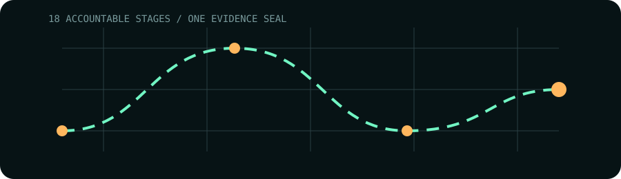
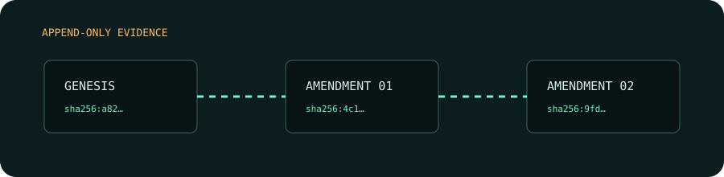

# ClauseForge



**Supplier AI Contract Amendment Impact Studio** — a local-first, evidence-bearing product for procurement counsel, AI-governance leads, control owners, and auditors.

ClauseForge turns proposed supplier-AI clause changes into policy-bounded obligation and control impact reviews. Its React console drives a versioned API through executable authentication, authorization, validation, correlation, deadline, error and observability behavior. A Rust composition service runs ten domain stages and eight exact-revision upstream responsibilities, then commits the result to a hash-linked, restart-safe evidence store.

## What makes the result accountable

- 26 meaningful Rust product crates reached from the service composition root.
- Six distinct Ruvnet projects: RuVector, ruv-FANN, midstream, QuDAG, guardrail and dspy.ts.
- Two enterprise projects: Open Policy Agent and LogAct.
- Typed API v1 plus checked TypeScript client.
- Explicit loading, empty, denial, recovery and success experiences.
- Three real browser journeys, including no-write denial and retrieval after backend restart.
- External evidence bound to the exact clean source commit.



## Run locally

Prerequisites are Linux, Rust 1.100, Node 24.21, Chromium for Playwright and exact-pinned upstream checkouts prepared by the selection probe. Set `CLAUSEFORGE_UPSTREAM_ROOT` if those checkouts are not in the run-default location.

```bash
npm --prefix frontend ci
npm --prefix frontend run build
./scripts/start.sh
```

Open <http://127.0.0.1:4173> during development, or <http://127.0.0.1:8787> after the built assets are served by Rust. Lifecycle commands are `scripts/readiness.sh`, `scripts/seed.sh`, `scripts/stop.sh`, and `scripts/reset.sh`.

## Verification

`scripts/collect-product-evidence.sh` executes ten suites: Rust, backend, frontend, API, middleware, integrations, benchmark, ablations, containers and browser. The immutable `scripts/verify-prototype.sh` then evaluates the external manifest, composition report, backend metadata, Rust source share, browser proof and semantic review. Evidence does not live in the checkout.

```bash
./scripts/collect-product-evidence.sh /absolute/external/evidence
DREAM_MACHINE_PRODUCER_RUN_ID=<real-run-id> node scripts/dream-machine-publication-gate.mjs --check . /absolute/external/evidence
```

## Safety and publication boundary

ClauseForge rehearses decisions; it does not trigger a real supplier amendment. The checked-in Cloud Run material is configuration only and performs no deployment. Publication is permitted only after complete local PASS and an independent semantic review. The exact controller must invoke the PR publisher as its child process; the publisher targets only Nick's personal `nicholas-ruest` account, opens a non-draft PR, and never merges.

## Design map

Start with [the product specification](docs/specification.md), [architecture](docs/architecture.md), [ADR index](docs/adr/README.md), [DDD index](docs/ddd/README.md), [integration matrix](docs/integration-matrix.md), and [traceability](docs/traceability.md). Exact upstream selection evidence and final suite receipts are intentionally external.

Licensed under Apache-2.0. Upstream projects retain their own licenses and marks; their names identify executed integrations, not endorsement.
